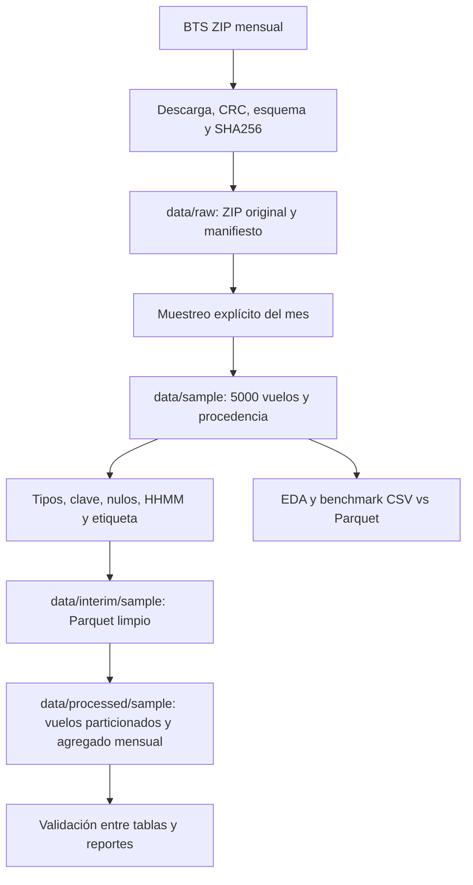
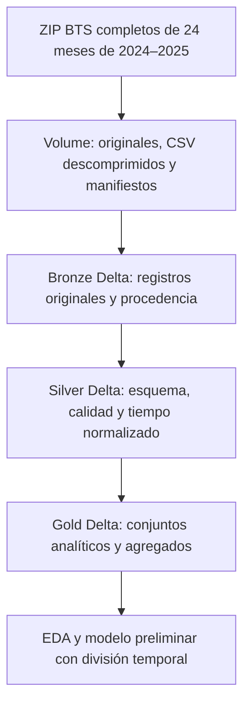

# Arquitectura actual y objetivo

## Punto de partida
El notebook original del equipo es [Proyecto_Notebook_original.ipynb](../notebooks/antecedentes/Proyecto_Notebook_original.ipynb). Se conserva intacto; sus salidas históricas se identifican como antecedentes. La reorganización agrega componentes ejecutables alrededor de ese trabajo.

## Flujo local implementado

`src/ingestion/bts.py` conserva el original. `src/processing/build_dataset.py` aplica el contrato local, elimina duplicados completos con conteo y rechaza claves con datos contradictorios. Mantiene cancelados con etiqueta nula y retrasos negativos. Exporta Parquet particionado por año/mes y un agregado mensual. `src/validation/validate_dataset.py` verifica tipos, volumen, etiqueta, corte y agregado.

Los archivos generados grandes viven fuera de Git; Git incluye solo muestra y evidencia pequeña. El modo local opera sobre la muestra, con pandas y PyArrow. El raw completo se obtiene por separado. La CI usa la muestra incluida, por lo que no depende de la disponibilidad de BTS.

## Arquitectura Databricks: Bronze completo; Silver y Gold pendientes

Correspondencia conceptual: raw → Bronze, interim → Silver, processed → Gold. Las carpetas locales no son tablas Delta. El catálogo real es `workspace` y el Volume es `/Volumes/workspace/bronze/vuelos_raw/vuelos`. La tabla ejecutada es `workspace.bronze.vuelos_raw`. Silver y Gold siguen siendo contratos pendientes, con los nombres acordados en `docs/guias/00_EMPEZAR_AQUI.md`.

Bronze ya usa esquema explícito PySpark, procedencia y reemplazo mensual Delta con conteos reales. Pendientes en Silver/Gold: tipos analíticos, dimensión verificable de aeropuertos/zonas, cuarentena, escrituras y pruebas entre sus tablas reales. Las tasas históricas requieren una política explícita de disponibilidad, además del tiempo del evento. No se incluye clima en este alcance.

## Escalabilidad y límites
La regeneración local carga un CSV mensual completo y no es distribuida. Los 24 meses de 2024–2025 originales guardan aproximadamente 14.08 millones de filas. Para estudiar escala procesar meses completos, medir operaciones equivalentes y observar memoria/tiempos; no presentar un benchmark de 5,000 filas como prueba de desempeño Spark.

Databricks/Delta facilitarían particiones, lecturas por columnas y procesamiento distribuido, pero se debe demostrar su conveniencia con mediciones. BTS es una fuente por lotes mensuales; no afirmar velocidad de streaming. El alcance final elegido por el usuario es enero 2024–diciembre 2025. Los archivos de otros años descargados durante la preparación no se incluyen en los conteos ni en el alcance de entrega.

## Módulos añadidos por Diego
- `validate_provenance`: hashes, equivalencia CSV/Parquet y periodo de la muestra.
- `acquire_range`: ZIP y CSV completos por mes, bloques, reanudación, fechas y manifiestos.
- `bronze`: esquema original de cadenas, metadatos e ingesta Delta idempotente por mes.
- `scripts/run_databricks.py`: transferencia ZIP y ejecución con la identidad segura de la CLI del integrante.
- `benchmark_scale`: procesos separados, muestra frente a mes completo y pico de memoria definido.

Los 24 meses completos y el piloto Databricks requieren sus respectivos reportes `complete=true`. La presencia de código no sustituye esa evidencia. Ver el contrato Bronze para la conexión con Silver y Gold.

La ejecución completa de Bronze finalizó con 14,080,680 filas de los 24 meses, en Spark 4.2.0. Enero 2025, cargado previamente como piloto, conservó 539,747 filas al reemplazarse durante el rango completo. Ver los reportes `databricks_bronze_result.json` y `databricks_bronze_validation.json`. Silver y Gold siguen pendientes de implementación e integración por sus responsables; las guías fijan firmas de funciones y tablas para que puedan trabajar sin duplicar módulos.
