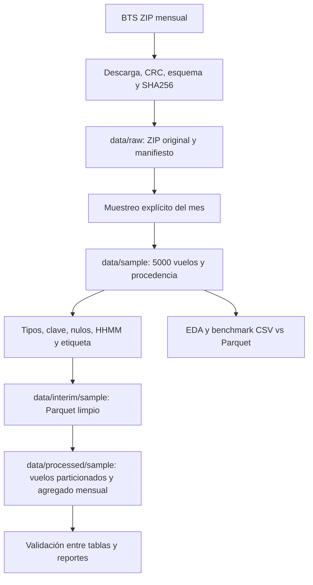
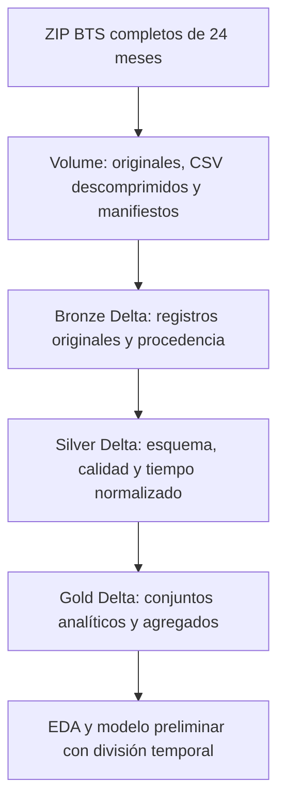

# Arquitectura actual y objetivo

## Punto de partida
El notebook original del equipo es [Proyecto_Notebook_original.ipynb](../notebooks/antecedentes/Proyecto_Notebook_original.ipynb). Se conserva intacto; sus salidas históricas se identifican como antecedentes. La reorganización agrega componentes ejecutables alrededor de ese trabajo.

## Flujo local implementado

`src/ingestion/bts.py` conserva el original. `src/processing/build_dataset.py` aplica el contrato local, elimina duplicados completos con conteo y rechaza claves con datos contradictorios. Mantiene cancelados con etiqueta nula y retrasos negativos. Exporta Parquet particionado por año/mes y un agregado mensual. `src/validation/validate_dataset.py` verifica tipos, volumen, etiqueta, corte y agregado.

Los archivos generados grandes viven fuera de Git; Git incluye solo muestra y evidencia pequeña. El modo local opera sobre la muestra, con pandas y PyArrow. El raw completo se obtiene por separado. La CI usa la muestra incluida, por lo que no depende de la disponibilidad de BTS.

## Arquitectura Databricks propuesta, pendiente

Correspondencia conceptual: raw → Bronze, interim → Silver, processed → Gold. Las carpetas locales no son tablas Delta. Tablas propuestas: `bronze.flights_raw`, `silver.flights_clean`, `gold.flight_features`, `gold.delay_monthly`, `gold.delay_distribution`. Los nombres del catálogo y Volume se documentarán cuando existan; no se inventan rutas de un workspace.

Pendientes: esquema explícito en PySpark, dimensión verificable de aeropuertos/zonas, cuarentena de errores, escrituras Delta idempotentes, pruebas sobre tablas reales y trazabilidad del job. Clima queda condicionado a una fuente válida al corte. Las dos tasas históricas exigen `available_at`, además del tiempo del evento.

## Escalabilidad y límites
La regeneración local carga un CSV mensual completo y no es distribuida. Los 24 meses originales guardan aproximadamente 14.08 millones de filas. Para estudiar escala procesar meses completos, medir operaciones equivalentes y observar memoria/tiempos; no presentar un benchmark de 5,000 filas como prueba de desempeño Spark.

Databricks/Delta facilitarían particiones, lecturas por columnas y procesamiento distribuido, pero se debe demostrar su conveniencia con mediciones. BTS es una fuente por lotes mensuales; no afirmar velocidad de streaming. La ampliación a 2023 queda como opción posterior, sin cambiar el alcance vigente de dos años.
